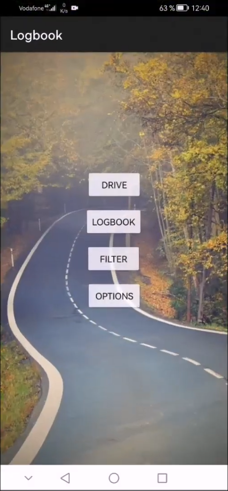
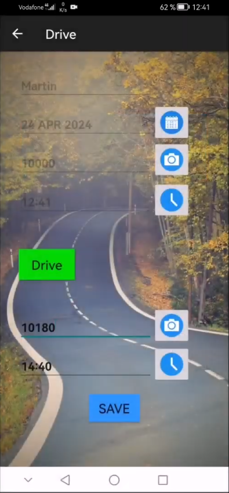
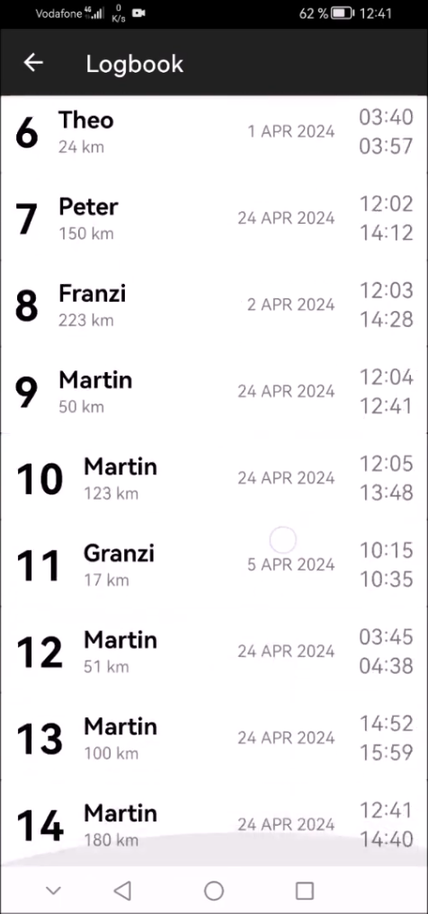
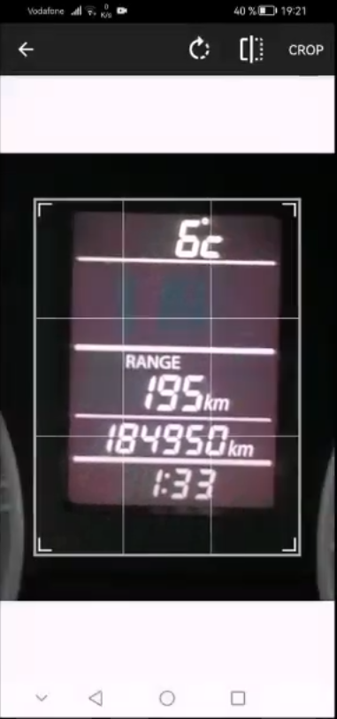

# Shared Car Logbook – Android App

[Video Demo](https://www.youtube.com/watch?v=k-yl5ljBSEs) | [Java Source](./app/src/main/java/com/example/sqltest) | [XML Layouts](./app/src/main/res/layout)

## Overview

An Android app I developed to track trips made by multiple drivers sharing a car. Users can record trips, calculate distances based on odometer readings, and view their driving history.

## Screenshots

**Main Menu · Trip Logging · Trip History · OCR Scanning**

  
  
  
  

## Features

- **OCR:** Scan odometer readings using the phone's camera and Google ML Kit.
- **Trip logging:** Record drivers, mileage, dates, and times.
- **Local storage:** Save and retrieve trips using SQLite.
- **Trip history:** View all trips and filter them by driver.
- **User interface:** Date/time pickers and support for English and German.

## Tech Stack

- **Language:** Java
- **UI:** Android XML layouts, RecyclerView
- **Database:** SQLite
- **OCR:** Google ML Kit
- **Image cropping:** [Android-Image-Cropper](https://github.com/ArthurHub/Android-Image-Cropper)

## Project Structure

The app consists of six Activities (Main, Drive, OCR, Logbook, Filter, Options) and two helper classes:

- `MyDatabaseHelper` – SQLite database operations
- `CustomAdapter` – Displays trip data in a RecyclerView
